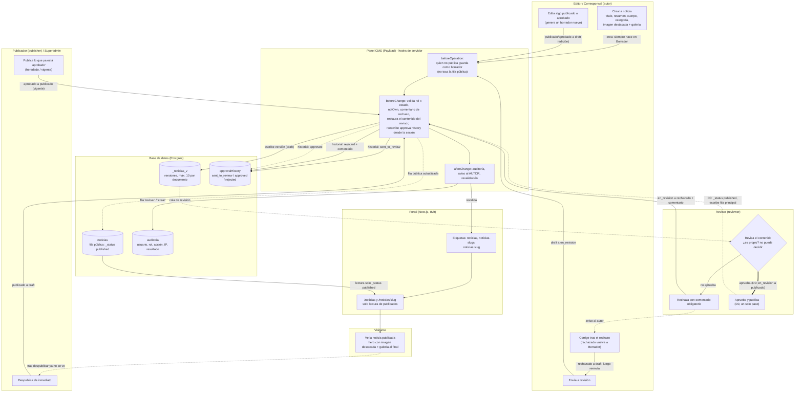

# Flujograma editorial — Noticias y Páginas (vigente + decisión D0)

**Estado:** documento descriptivo, 2026-10-23. Reemplaza a `docs/FLUJO_EDITORIAL.md` en lo relativo a **quién publica** y a las transiciones. No cambia código. Fuentes: `apps/cms/src/hooks/editorial/transitions.ts`, `enforceTransition.ts`, `afterTransition.ts`, `access/roles.ts`, `collections/Noticias.ts`, `fields/approvalHistory.ts`, `docs/specs/security/SEC-03-matriz-editorial.md` y la enmienda `docs/specs/editorial/SEC-03-D0-revisor-publica.md`.

**Leyenda de estado de implementación**
- Trazo continuo: regla **vigente** en el código.
- Trazo punteado y etiqueta `D0`: regla **decidida** el 2026-10-23, **aún no implementada** (ver la enmienda). Hasta implementarla, el paso de publicar lo hace el Publicador sobre lo `aprobado`.

## 1. Estados y quién actúa

| Estado (`approvalStatus`) | `_status` | Lo fija | Siguiente paso |
|---|---|---|---|
| `draft` (Borrador) | `draft` | Editor, Corresponsal (solo lo propio) | Enviar a revisión |
| `en_revision` | `draft` | El autor al enviar | Revisor: rechazar, o aprobar y publicar (D0) |
| `rechazado` | `draft` | Revisor, con comentario obligatorio | El autor lo devuelve a Borrador y corrige |
| `aprobado` | `draft` | (vigente) Revisor; con D0 queda solo como estado heredado | Publicador publica |
| `publicado` | `published` | (vigente) Publicador; con D0, el Revisor | Despublicar (Publicador/Superadmin) o editar (vuelve a Borrador) |

Reglas fijas: nadie aprueba ni publica lo propio (`notOwn`); rechazar exige comentario; el servidor rechaza cualquier otro salto (403 si el rol no tiene autoridad, 422 si el origen no lo admite); editar algo aprobado o publicado crea un borrador nuevo y no retira lo público.

## 2. Flujo completo con carriles

## 3. Qué se escribe en la base de datos en cada paso

| Paso | Quién | `noticias` (fila principal) | `_noticias_v` (versiones) | `approvalHistory` | `auditoria` |
|---|---|---|---|---|---|
| Crear | Editor/Corresponsal | Se crea en `draft/draft` con `createdBy` = autor (lo fija el servidor) | Versión inicial | vacío | `crear` |
| Enviar a revisión | Autor | No se toca (guarda como borrador) | Nueva versión `en_revision` | `sent_to_review` | `revisar` |
| Rechazar | Revisor | No se toca | Nueva versión `rechazado` | `rejected` + comentario | `rechazar` |
| Corregir | Autor | No se toca | Nueva versión `draft` | sin cambio | `actualizar` |
| Aprobar (vigente) | Revisor | No se toca | Versión `aprobado` | `approved` | `aprobar` |
| Publicar (vigente) | Publicador | **Se escribe**: `_status published`, `approvalStatus publicado` | Versión publicada | sin entrada (el enum no tiene «publicado») | `publicar` |
| Aprobar y publicar (D0) | Revisor | **Se escribe** igual que arriba | Versión publicada | `approved` | `publicar` («aprobada y publicada») |
| Despublicar | Publicador/Superadmin | Vuelve a `draft` | Versión nueva | sin cambio | `actualizar` («despublicada») |
| Intento denegado (403) | cualquiera | no cambia | no cambia | no cambia | fila con resultado `error` |

El contenido que cambia un Revisor o Publicador se **restaura** del original: solo mueven campos de estado.

## 4. Imágenes de la noticia

- `featuredImage` (relación a `media`): imagen principal. Decisión D2/D3 (PO, 2026-10-23): toda noticia debe tener imagen destacada; el diseño final es de ancho completo desde el encabezado, con degradé verde, ruta de migas, título y resumen encima; la galería va **al final** (ver `docs/specs/migration/MIG-IMG-imagenes-de-noticias.md`, sección «Decisiones del Product Owner (2026-10-23)»).
- `gallery` (hasta 30 fotos con epígrafe): carrusel al final del artículo.
- `featuredImageUrl` (URL externa): campo heredado que se deprecará (D4): todas las imágenes salen de nuestro almacenamiento.
- Lectura de `media` pública por URL (D1): una imagen de un borrador es alcanzable por quien conozca la URL; no expone la base de datos.

## 5. Notas de eficiencia y seguridad

| Tema | Qué hace | Dónde |
|---|---|---|
| PERF-DB: versiones | `maxPerDoc: 10` en lugar de 100 versiones completas (JSON Lexical) por documento. | `collections/Noticias.ts` y `Paginas.ts:91` |
| PERF-DB: consultas | Listados con `select`, `depth` 1 y `limit` acotado (50 por defecto, 100 máximo); sin `content` en listados; detalle `depth` 2. | `lib/cms/queries/news.ts` (`clampLimit`, `LIST_SELECT_FIELDS`) |
| PERF-DB: prerender | Solo las 20 noticias más recientes se prerenderizan; el resto, bajo demanda. | `lib/cms/staticParams.ts` (`NEWS_PRERENDER_LIMIT = 20`) |
| PERF-DB: índices | `noticias_featured_idx` (y su versión), `auditoria_fecha_hora_idx`. Migración solo hacia adelante. | `apps/cms/src/migrations/20261023_150000_perf_db_indexes.ts` |
| Revalidación | Cada guardado invalida `noticias`, `noticias-slugs` y `noticias:<slug>`; el borrado también. Con reintentos y tiempo límite, sin bloquear el guardado. | `Noticias.ts` (`afterChange`, `afterDelete`); `utilities/revalidation.ts` |
| Separación de funciones | `notOwn`: nadie aprueba ni publica lo propio. Con `createdBy` nulo (heredadas) no se bloquea. | `transitions.ts:347`, `:263` |
| Auditoría | Una fila por guardado con la acción de la transición; los intentos denegados (403) también. | `afterTransition.ts:22`; `enforceTransition.ts:67` |
| Historial a prueba de manipulación | `approvalHistory` lo escribe solo el servidor; lo que envía el cliente se descarta. | `fields/approvalHistory.ts`; `enforceTransition.ts:91` |
| Sin GraphQL | GraphQL deshabilitado para no abrir una segunda vía de lectura/escritura. | prueba `tests/unit/cms-graphql-disabled.spec.ts` |
| Control de acceso | Anónimo y roles sin función editorial solo leen `_status: published`; el Corresponsal lee lo publicado y lo suyo; el Auditor no lee borradores. | `access/roles.ts:199-233` |
| Escritura como borrador | Todo usuario que no es Publicador guarda siempre como borrador, así una edición no cambia lo público. | `enforceTransition.ts:129` |

## 6. Qué no cubre este diagrama

Publicación de emergencia del Superadministrador (DEP-03c), filtro por unidad del Corresponsal, flujo de borrado y colecciones sin flujo editorial (Facultades, Carreras, etc.).
