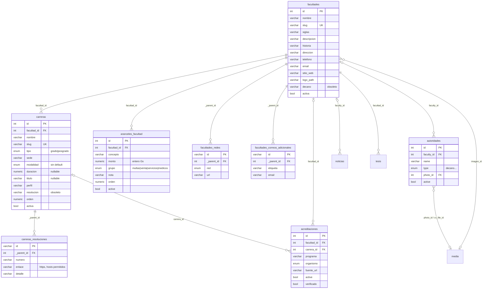

# FAC-01 — Página de facultad conectada al CMS (piloto: Facultad de Odontología)

**Estado:** implementado en local (rama `security/rbac-foundation`), sin commit. **Ámbito:** página
`/[locale]/facultades/odontologia`, componentes reutilizables `components/facultades/*`, módulo puro
`lib/cms/facultad.ts`, consulta `lib/cms/queries/facultad.ts`, colecciones `facultades`, `carreras` y la nueva
`aranceles-facultad`, siembra `scripts/seed-odontologia.mjs` + `scripts/lib/odontologiaSeedData.mjs`, migración
`20261025_200000_fac_01_facultad_detalle`. **Fuera de alcance (siguiente paso):** convertir las otras cinco páginas de
facultad (siguen con su código actual), página de detalle por carrera, mapa embebido.

## 1. Problema (auditoría del estado al 25-10-26)

| # | Hecho observado | Evidencia |
|---|---|---|
| F1 | La página tenía 28 aranceles ESCRITOS EN EL CÓDIGO (`ARANCELES`) y 9 carreras de demostración (`DEMO_GRADO`, `DEMO_POSGRADO`) que se mostraban cuando el CMS no devolvía carreras. | `app/[locale]/facultades/odontologia/page.tsx` (versión anterior, l. 14-68 y 139-140) |
| F2 | La tabla `carreras` tenía 0 filas en la BD local: la página publicaba SIEMPRE los datos de demostración. | `select count(*) from carreras` (25-10-26) |
| F3 | Una fila de demostración decía «Odontología (reacreditación) 497/21». En la fuente, 497/21 es otra resolución CONES de la misma carrera («CONES ACTUALIZACION ODONTOLOGIA»); no es una acreditación. | `https://www.unc.edu.py/facultad-de-odontologia/` (columna «Res. CONES»); `https://www.founc.edu.py/certificados-y-acreditaciones/` |
| F4 | El subtítulo «Programas de formación de grado acreditados por el CONES» es incorrecto: el CONES habilita carreras, la ANEAES acredita. | `messages/es/pages.facultades.odontologia.json` (`grado.subtitle`); `docs/specs/portal/PREMIOS-ACREDITACIONES.md` |
| F5 | El héroe mostraba «30+ años de trayectoria»: la universidad se creó en 2007 (Ley 3201) y la facultad funciona desde 2007. Cifra inventada. | página anterior l. 206; `https://www.founc.edu.py/sobre-founc/` |
| F6 | La siembra anterior inventaba `duracion` (5, 4, 2) y `titulo` para cada carrera; la fuente no los publica. | `scripts/seed-odontologia.mjs` (versión anterior) |
| F7 | `carreras.duracion` y `carreras.titulo` eran obligatorios: obligaban a inventar un dato para poder cargar una carrera. | `apps/cms/src/collections/Carreras.ts` (versión anterior) |
| F8 | `facultades` y `carreras` tenían `read: () => true`: un anónimo leía por REST/GraphQL filas desactivadas (brecha SEC-10). | ambas colecciones, `access.read` |
| F9 | Dirección, teléfono, correos y sitio web estaban en el JSON de traducciones y en el código, no en el CMS. | página anterior l. 302-369; JSON de traducciones |
| F10 | Tema oscuro (`#0c1c0c`) distinto del de las páginas rediseñadas (/marco-legal, /convenios, /aranceles-rectorado). | página anterior |

### 1.1 Fuentes consultadas (25-10-26, 4 solicitudes, User-Agent `unc-portal-migration/1.0 (inventario autorizado)`)

| Id | URL | Qué aporta |
|---|---|---|
| S1 | `https://www.unc.edu.py/facultad-de-odontologia/` | Carreras de grado y posgrado con sede y Res. CONES (con enlace a Drive), 28 aranceles en 4 grupos, dirección, teléfono, dos correos, sitio web. |
| S2 | `https://www.founc.edu.py/` (sitio oficial de la facultad; `http://www.founc.edu.py` redirige a https) | Siglas «FOUNC» (dominio, menú «Sobre F.O.U.N.C.», «Revista FOUNC»), redes X, Facebook, Instagram. |
| S3 | `https://www.founc.edu.py/sobre-founc/` | Historia de la facultad (2007: Facultad de Ciencias de la Salud, carrera de Odontología; Res. Rectorado 007/2007; 43 alumnos; 2011 Facultad de Odontología). |
| S4 | `https://www.founc.edu.py/certificados-y-acreditaciones/` | Lista de documentos: Superintendencia de Salud, «CONES actualización Odontología», primera y segunda acreditación FOUNC (sin datos de vigencia en la página). |

HTML crudo guardado solo en el scratchpad de la sesión (no en el repositorio).

**No publicado por falta de fuente (por confirmar):** duración y título de cada carrera, perfil del egresado,
modalidad, misión/visión, horario de atención, fotografía de portada, vigencia de la acreditación ANEAES.

## 2. Comportamiento

1. **Fuente única:** todo dato de la facultad sale del CMS. Sin datos de demostración, sin cifras en el código. Los
   textos de interfaz (títulos de sección, etiquetas) salen de `messages/*/pages.facultades.json` (clave `detalle`).
2. **Estados:** `ok` (hay facultad activa), `not-found` (no existe o está inactiva → 404) y `unavailable` (el CMS no
   respondió al pedir la facultad → aviso neutro, nunca datos inventados). Cada sección secundaria (carreras,
   decano, acreditaciones, aranceles) tiene su propio estado `ok | empty | unavailable`; una sección vacía o caída
   se OCULTA (y su entrada del índice), salvo carreras: si falla se muestra un aviso neutro, si está vacía, un aviso
   «aún no hay carreras publicadas».
3. **Héroe:** nombre de la facultad en serif grande, siglas solo si existen, una línea de presentación
   (`descripcion`) solo si existe, logo (`logoPath`) en una placa blanca, y una ficha con el número REAL de carreras
   de grado y de posgrado (contadas a partir de los datos) y el decano (si hay). Nunca «años de trayectoria».
4. **Índice de la página:** columna fija a la izquierda en pantallas anchas; fila de enlaces desplazable en móvil.
   Solo lista las secciones visibles.
5. **Carreras:** filas (no tarjetas) ordenadas por `orden` y luego por nombre. Cada fila: nombre, datos
   disponibles (sede, modalidad, duración, título; solo los que existen) y las resoluciones CONES como enlaces al
   documento (solo hosts permitidos: `drive.google.com`, `www.unc.edu.py`, `unc.edu.py`, `www.founc.edu.py`,
   `founc.edu.py`). Etiqueta «Res. CONES» (habilitación), nunca «acreditación».
6. **Decanato:** del CMS `autoridades` (`type = decano`, `faculty = facultad`, `active`). Foto por
   `resolveMediaUrl`; sin foto, iniciales (`getInitials`). Enlace a /autoridades.
7. **Acreditación:** solo filas de `acreditaciones` de la facultad con `active` Y `verificado` y vigencia no vencida
   (`mapAccreditations`). Hoy ninguna está verificada: la sección no aparece. Nunca se afirma una acreditación
   sin esa marca.
8. **Aranceles:** del CMS `aranceles-facultad` (`facultad = facultad`, `active`), en tablas reales por grupo, monto
   con `formatMonto` (Gs. 10.000). Vacío → la sección se oculta.
9. **Contacto:** dirección, teléfono (enlace `tel:` solo con dígitos), correos (`mailto:`), sitio web y redes
   (solo `https://` de hosts permitidos por red). «Ver en el mapa» solo si hay dirección (búsqueda en
   OpenStreetMap con la dirección + «Concepción, Paraguay»).
10. **Accesibilidad e impresión:** `main` con encabezados h1→h2→h3, `nav` con `aria-label`, contraste AA, foco
    visible, objetivos ≥ 44 px, `prefers-reduced-motion` sin desplazamiento, aparición solo con CSS
    (`.lt-reveal`, sin JS; sin soporte, el contenido se ve desde el inicio), estilos de impresión sin fondos.
11. **Revalidación:** etiquetas ISR `facultades`, `carreras`, `autoridades`, `acreditaciones`,
    `aranceles-facultad`, más un `revalidate` de seguridad de 1 hora.

## 3. Modelo de datos

Decisión general: **reutilizar** lo que existe y agregar solo lo que esta página necesita y tiene fuente.

### 3.1 `facultades` (se agrega)

| Campo | Tipo | Regla | Por qué |
|---|---|---|---|
| `historia` | textarea ≤ 2000 | opcional | Reseña breve (S3). Texto plano: React lo escapa. |
| `direccion` | text ≤ 200 | opcional | Antes en el JSON de traducciones (F9). |
| `correosAdicionales` | array ≤ 4 de {`etiqueta` text ≤ 60 opcional, `email` email} | opcional | La fuente publica dos correos sin rótulo; `email` sigue siendo el principal. |
| `sitioWeb` | text | `https://` bien formado | Sitio propio de la facultad (S2). |
| `redes` | array ≤ 6 de {`red` select facebook/instagram/x/youtube, `url`} | `url` https y host permitido por red | Evita enlaces engañosos con la marca UNC. |

Se **reutiliza**: `descripcion` (presentación de una línea), `email`, `telefono`, `siglas`, `logoPath`, `imagen`
(portada, upload a `media`; sin imagen no se pinta foto, se usa el logo), `activa`.

**`activa` NO se renombra a `active`.** Lo leen `lib/cms/queries/facultades.ts`, `carreras.ts`, las seis páginas de
facultad, `/facultades`, la siembra y tests; renombrarlo obligaría a migrar todos a la vez. En su lugar, el acceso de
lectura usa `readFlagOrInstitutional('activa')` (mismo criterio que `readActiveOrInstitutional`, otro nombre de
campo). Límite: un anónimo deja de ver facultades inactivas también dentro de relaciones pobladas (noticias, tesis);
hoy las 6 están activas.

**Duplicación conocida:** `facultades.decano` (texto) repite el dato de `autoridades`. La página nueva NO lo usa;
lo siguen usando `/facultades` y `/facultades/[slug]`. Se marca como obsoleto en el panel; borrarlo es un paso
posterior (decisión del PO).

`orden` y `horario` no se agregan: ninguna fuente da un horario y el listado se ordena por nombre.

### 3.2 `carreras` (se cambia)

- `duracion` y `titulo` pasan a **opcionales** (F7). `duracion` acepta 1-12 años con un decimal.
- `perfil` (textarea ≤ 2000, opcional): perfil del egresado; hoy vacío (sin fuente).
- `resoluciones` (array ≤ 6 de {`numero` text con forma `\d{1,4}/\d{2,4}`, `enlace` https de host permitido,
  `detalle` text ≤ 80 opcional}): resoluciones CONES de habilitación. Odontología tiene dos (165/15 y 497/21).
- `orden` (number ≥ 0, por defecto 99): orden dentro de su tipo.
- `resolucion` (texto) queda como **obsoleto**: lo leen las otras cinco páginas. El mapeo nuevo usa `resoluciones`
  y, si está vacío, cae a `resolucion` sin enlace.
- Lectura: `readFlagOrInstitutional('activa')`.
- La relación con `acreditaciones` ya existe (`acreditaciones.carrera`, `acreditaciones.facultad`): no se duplica.

### 3.3 `aranceles-facultad` (colección nueva)

Misma forma y validación que `aranceles-rectorado` más la facultad: `facultad` (relación obligatoria, índice),
`concepto` (≤ 200, normalizado), `monto` (entero 0-100.000.000 Gs.), `grupo` (select `multas | venta | servicios |
medicos`, los cuatro grupos de S1), `nota` (≤ 300, opcional), `orden` (≥ 0, por defecto 99), `active`.
Índice único (`facultad`, `grupo`, `concepto`). Lectura `readActiveOrInstitutional`; escritura
`canWriteInstitutional`; auditoría y revalidación (`aranceles-facultad`) al guardar y al borrar. **No se mezcla con
`aranceles-rectorado`** (otra fuente, otra autoridad que fija los montos).

Decisión sobre los montos de la página anterior: los 28 coinciden con S1 (página oficial de la UNC). Se migran al
CMS con el concepto tal como lo escribe S1 (p. ej. «Carpeta p/concurso»). S1 no indica resolución ni fecha.

## 4. Escenarios (Given / When / Then)

1. **Dado** la facultad activa con 2 carreras de grado y 6 posgrados en el CMS, **cuando** se abre
   `/facultades/odontologia`, **entonces** se ven esas filas, la ficha dice «2» y «6» y no aparece ningún dato
   que no esté en el CMS.
2. **Dado** el CMS sin carreras de la facultad, **cuando** se abre la página, **entonces** se ve el aviso
   «aún no hay carreras publicadas» y NINGUNA carrera de demostración. (Negativo.)
3. **Dado** el CMS caído, **cuando** se pide la facultad, **entonces** la página responde con un aviso neutro, sin
   500 y sin datos inventados. (Negativo.)
4. **Dado** una carrera con `activa = false`, **cuando** un anónimo pide `/api/carreras`, **entonces** no la recibe;
   un superadmin sí. (Negativo, SEC-10.)
5. **Dado** un anónimo, **cuando** hace `POST /api/aranceles-facultad`, **entonces** recibe 403. (Negativo.)
6. **Dado** un arancel con monto 10.5, −1 o 200.000.000, **cuando** se guarda, **entonces** el CMS lo rechaza con un
   mensaje en español; si llega igual a la página (fila corrupta en la BD), el mapeo lo descarta. (Negativo.)
7. **Dado** una resolución con enlace `https://evil.example/x.pdf`, `http://drive.google.com/...` o
   `javascript:...`, **cuando** se guarda, **entonces** el CMS lo rechaza; si llega a la página, se muestra el
   número sin enlace. (Negativo.)
8. **Dado** una red social `facebook` con URL de otro host, **cuando** se guarda, **entonces** se rechaza; en la
   página no se enlaza. (Negativo.)
9. **Dado** una acreditación de la facultad con `active = true` y `verificado = false`, **cuando** se abre la página,
   **entonces** NO aparece la sección de acreditación. (Negativo.)
10. **Dado** una acreditación `active` y `verificado` vigente, **cuando** se abre la página, **entonces** se ve el
    sello «Acreditada por ANEAES» con el programa y el enlace a la fuente.
11. **Dado** el decano con foto, **cuando** se abre la página, **entonces** se ve la foto; sin foto, sus iniciales.
12. **Dado** que se edita una carrera en el panel, **cuando** el CMS avisa al portal (etiqueta `carreras`),
    **entonces** la página muestra el cambio sin redeploy.
13. **Dado** la siembra ejecutada dos veces, **cuando** se compara la BD, **entonces** no hay filas duplicadas y
    ningún campo editado por el PO fue sobrescrito (solo se completan campos vacíos).
14. **Dado** `--dry-run`, **cuando** se ejecuta la siembra, **entonces** no hay ninguna solicitud de red.
15. **Dado** `CMS_URL` remoto sin `--allow-remote` o con `http://` remoto, **cuando** se ejecuta la siembra,
    **entonces** se niega a correr. (Negativo.)

## 5. Datos sembrados (procedencia en `scripts/lib/odontologiaSeedData.mjs`)

Cada hecho lleva `sourceUrl` (S1-S4). Facultad: siglas, descripción (frase factual derivada de S1/S3), historia
(resumen de S3), dirección, teléfono, 2 correos, sitio web, 3 redes. Carreras: 2 de grado (Odontología con 165/15 y
497/21; Licenciatura en Prótesis Dental 709/16) y 6 posgrados, todos «Central/Concepción», sin duración ni título.
Aranceles: 28 filas en 4 grupos. Acreditaciones: no se tocan (decisión del PO, ver
`PREMIOS-ACREDITACIONES.md`).

## 6. RDD — afirmación → evidencia

| Id | Afirmación | Evidencia | Tipo |
|---|---|---|---|
| RDD-FAC-01 | La página publicaba datos de demostración siempre (F1, F2). | código anterior + `count(*) = 0` | hecho observado |
| RDD-FAC-02 | 497/21 es una resolución CONES de actualización, no una reacreditación (F3). | S1 columna «Res. CONES»; S4 «CONES ACTUALIZACION ODONTOLOGIA» | hecho observado |
| RDD-FAC-03 | CONES habilita, ANEAES acredita (F4). | `PREMIOS-ACREDITACIONES.md` (evidencia ya registrada) | documentación |
| RDD-FAC-04 | Las siglas oficiales son FOUNC. | S2: dominio `founc.edu.py`, menú «Sobre F.O.U.N.C.», «Revista FOUNC» | hecho observado |
| RDD-FAC-05 | Los 28 aranceles son los publicados por la UNC. | S1, tabla «Aranceles» | hecho observado |
| RDD-FAC-06 | Duración, título y perfil no tienen fuente pública. | S1, S2 (sin esos datos) | hecho observado |
| RDD-FAC-07 | Sin control de host, un enlace del CMS podría llevar a un sitio ajeno con la marca UNC. | `validateAllowedHostUrl` (MLG-01) | riesgo condicionado |
| RDD-FAC-08 | Un anónimo podía leer carreras/facultades inactivas. | `read: () => true` (F8) | hecho observado |

## 7. Rollback

Revertir los archivos del cambio. La migración `fac_01` tiene `down`, que se niega a correr si hay filas en
`aranceles_facultad`, `carreras_resoluciones`, `facultades_redes` o `facultades_correos_adicionales`; vuelve a poner
NOT NULL en `duracion`/`titulo` solo si ninguna fila los tiene vacíos. Los datos sembrados se retiran desmarcando
«Publicado»/«Activa» en el panel (no se borran: queda el historial en Auditoría).

## 8. Decisiones pendientes del PO

1. Duración, título y perfil de cada carrera (Secretaría Académica de la FOUNC).
2. Acreditación ANEAES de Odontología: ¿activar y verificar la fila con resolución y vigencia oficiales?
3. Vigencia de los aranceles de la facultad (S1 no da fecha ni resolución).
4. Fotografía de portada (subir a Media y asignar en «Imagen»).
5. Borrar `facultades.decano` y `carreras.resolucion` cuando las otras cinco páginas usen la versión nueva.
6. ¿Pasar las seis facultades a la ruta dinámica `/facultades/[slug]` con estos componentes?

## 9. Base de datos: tablas y relaciones de las facultades (Postgres local, 26-10-26)

Derivado en solo lectura de `pg_constraint` e `information_schema` del contenedor `unc-postgres-local`
(sin tablas internas `payload_*`). Filas al 26-10-26: `facultades` 6, `carreras` 8 (todas de Odontología),
`carreras_resoluciones` 9, `facultades_redes` 3, `facultades_correos_adicionales` 1, `aranceles_facultad` 28,
`autoridades` 8, `acreditaciones` 7 (ninguna `active` + `verificado`).

| Tabla hija | Columna FK | → Tabla | Nulo | ON DELETE | Cardinalidad |
|---|---|---|---|---|---|
| `carreras` | `facultad_id` | `facultades` | NO | SET NULL | facultad 1 — N carreras |
| `carreras_resoluciones` | `_parent_id` | `carreras` | NO | CASCADE | carrera 1 — 0..6 resoluciones |
| `facultades_redes` | `_parent_id` | `facultades` | NO | CASCADE | facultad 1 — 0..6 redes |
| `facultades_correos_adicionales` | `_parent_id` | `facultades` | NO | CASCADE | facultad 1 — 0..4 correos |
| `aranceles_facultad` | `facultad_id` | `facultades` | NO | SET NULL | facultad 1 — N aranceles (único: facultad + grupo + concepto) |
| `autoridades` | `faculty_id` | `facultades` | SÍ | SET NULL | facultad 0..1 — N autoridades (el decano: `type = decano`) |
| `autoridades` | `photo_id`, `cv_file_id` | `media` | SÍ | SET NULL | autoridad — 0..1 foto / 0..1 CV |
| `acreditaciones` | `facultad_id` | `facultades` | SÍ | SET NULL | facultad 0..1 — N acreditaciones |
| `acreditaciones` | `carrera_id` | `carreras` | SÍ | SET NULL | carrera 0..1 — N acreditaciones |
| `facultades` | `imagen_id` | `media` | SÍ | SET NULL | facultad — 0..1 imagen de portada |
| `noticias`, `_noticias_v` | `faculty_id`, `version_faculty_id` | `facultades` | SÍ | SET NULL | facultad 0..1 — N noticias |
| `tesis` | `facultad_id` | `facultades` | NO | SET NULL | facultad 1 — N tesis |

**Hallazgo (para el PO):** en `carreras`, `aranceles_facultad` y `tesis` la FK es NOT NULL con `ON DELETE SET NULL`
(lo genera Payload para una relación `required`). En la práctica Postgres **rechaza** borrar una facultad que tenga
carreras, aranceles o tesis (actúa como RESTRICT). Es el comportamiento deseado (una facultad se retira con
`activa = false`, no se borra), pero el error del panel es técnico.

`aranceles_rectorado` NO tiene relación con `facultades` (lista del Rectorado; no se mezcla).

